# MAX-FIT | Direct-to-Customer Men's Clothing Store with AI Virtual Try-On

MAX-FIT is a direct-to-customer men's clothing store with AI virtual try-on, engineered for modern web browsers. Built as a focused niche for men's casual and everyday wear, the platform integrates an AI Virtual Try-On studio powered by IDM-VTON neural diffusion, Razorpay test payments, server-authoritative GST billing, biometric size recommendations, automated PDF invoice generation, a four-stage order delivery tracker, and an administrative console with direct image uploads and inventory management.

---

## 🏛 System Architecture

```mermaid
graph TD
    Customer([Customer / Client Browser])
    Admin([Store Administrator])

    subgraph ClientApp [Client Application - React 19 + Vite 6 + Tailwind CSS v4]
        StorefrontUI[Storefront & Product Catalog]
        TryOnStudioUI[AI Virtual Try-On Studio]
        SliderComp[Before / After Comparison Slider]
        CheckoutUI[Checkout & Payment Stepper]
        AdminUI[Admin Management Console]
        AuthCtx[Auth Context - Supabase Auth]
        CartCtx[Cart Context - Server Synced]
        RzpSDK[Razorpay Checkout SDK]
    end

    subgraph ServerApp [Application Backend - Node.js 25 + Express ES Modules]
        Router[Express REST API /api/v1]
        AuthGuard[JWT Auth & Admin Middleware]
        RateLimit[Express Rate Limiters]
        ProductCtrl[Catalog & Category Controller]
        CartCtrl[Authoritative Cart & Pricing Controller]
        PaymentCtrl[Razorpay Order & Signature Verifier]
        OrderCtrl[Order Fulfillment & Status Controller]
        VTONSvc[IDM-VTON Gradio Client Service]
        InvoiceSvc[PDFKit Vector Invoice Generator]
        SizeSvc[Biometric Size Recommendation Engine]
    end

    subgraph DataAndCloud [Cloud Infrastructure & Managed Services]
        SupabaseDB[(PostgreSQL 15 + Row Level Security)]
        StorageProducts[(Storage Bucket: products - Public)]
        StorageUploads[(Storage Bucket: tryon-uploads - Private)]
        StorageResults[(Storage Bucket: tryon-results - Private)]
        StorageInvoices[(Storage Bucket: invoices - Private)]
        HFInference[Hugging Face Spaces - yisol/IDM-VTON]
        RazorpayAPI[Razorpay Payment Gateway API]
    end

    Customer --> StorefrontUI
    Customer --> TryOnStudioUI
    Customer --> CheckoutUI
    Admin --> AdminUI

    StorefrontUI --> Router
    TryOnStudioUI --> Router
    CheckoutUI --> Router
    CheckoutUI --> RzpSDK
    AdminUI --> Router

    Router --> AuthGuard
    Router --> RateLimit
    Router --> ProductCtrl
    Router --> CartCtrl
    Router --> PaymentCtrl
    Router --> OrderCtrl
    Router --> VTONSvc
    Router --> InvoiceSvc
    Router --> SizeSvc

    ProductCtrl --> SupabaseDB
    ProductCtrl --> StorageProducts
    CartCtrl --> SupabaseDB
    PaymentCtrl --> SupabaseDB
    PaymentCtrl --> RazorpayAPI
    OrderCtrl --> SupabaseDB
    VTONSvc --> HFInference
    VTONSvc --> StorageUploads
    VTONSvc --> StorageResults
    InvoiceSvc --> StorageInvoices
```



---

## ✨ Core Features

1. **AI Virtual Try-On Studio (IDM-VTON)**
   - Upload any front-facing portrait (client-side compressed to 768 × 1024).
   - Select any upper garment from the catalogue.
   - Diffusion neural model synthesizes realistic garment drape and natural lighting.
   - Interactive horizontal Before/After Split Comparison Slider.
   - Direct "Add this fit to Bag" and High-Resolution Download.
   - "My Saved Fits" gallery for reviewing and deleting past try-on generations.

2. **Men's Catalog & Category Architecture**
   - 62 curated products across 7 dedicated men's categories.
   - 321 product variants with 4,391 live stock units.
   - Category-tailored sizing: Chest letter sizes (`S`, `M`, `L`, `XL`, `XXL`) for tops; Waist numeric measurements (`28`, `30`, `32`, `34`, `36`, `38`) for bottoms.
   - Fast search, category filtering, price range slider, and in-stock toggle.

3. **Biometric Size Recommender Engine**
   - Rule-based algorithmic size recommendation matching user height, weight, optional chest/waist measurements, and fit preference (`Slim`, `Regular`, `Relaxed`).
   - Integrated live variant stock verification.
   - Biometric details saveable directly to customer profile.

4. **Authoritative Cart & Dynamic Pricing**
   - Server-enforced financial calculations preventing client-side tampering.
   - Dual-tier apparel GST computation: 5% GST on items under ₹1,000; 12% GST on items ₹1,000 and above.
   - Promotional coupon validation (`WELCOME10`, `FLAT200`, `MAXFIT30`) with minimum order constraints and maximum discount ceilings.
   - Transparent delivery policy: Free shipping on orders ₹999 and above; flat ₹79 otherwise.

5. **Razorpay Payments & Atomic Inventory Control**
   - Razorpay test mode payment creation and checkout modal launch.
   - Timing-safe HMAC SHA256 signature verification.
   - Atomic inventory decrements via PostgreSQL procedure `decrement_variant_stock` to prevent race conditions and overselling.
   - Payment retry workflow for pending orders.
   - Order cancellation with automatic inventory restoration via `restore_variant_stock`.

6. **Order Tracking & Vector PDF Invoices**
   - 4-stage visual delivery tracker: *Order Placed* &rarr; *Ready to be Shipped* &rarr; *In Transit* &rarr; *Delivered*.
   - Automated server-side GST tax invoice generation via `pdfkit` upon payment capture.
   - Secure invoice delivery via short-lived signed URLs from private storage.

7. **Direct Single-Item "Buy Now" Checkout**
   - Instant single-item purchase path bypassing the regular cart.
   - Server-side preview endpoint (`/cart/buy-now-preview`) computing live item subtotal, shipping fee, and GST.

8. **Administrative Console (`/admin`)**
   - Role-protected dashboard accessible to designated administrators.
   - Business metrics: total revenue, orders, low-stock alerts, and try-on success rates.
   - Product catalog editor with direct computer image upload to Supabase Storage, 3:4 portrait resolution specifications, and automatic garment sizing adaptation.
   - Dedicated inventory management with inline stock adjustments.
   - Order fulfillment manager with live delivery stage updates.
   - Promotional coupon manager with activation controls.

---

## 👔 Men's Product Categories

The MAX-FIT catalog organizes men's wear into 7 specialized categories:

| Category Name | Slug | Garment Type | Sizing Scheme | Products | Price Range (INR) | Try-On Studio |
| :--- | :--- | :--- | :--- | :---: | :---: | :---: |
| **Cargo** | `cargo` | Bottoms | Waist: 28, 30, 32, 34, 36, 38 | 3 | ₹899 – ₹949 | Manual Toggle |
| **Casual Shirts** | `casual-shirts` | Tops | Chest: S, M, L, XL, XXL | 17 | ₹499 – ₹899 | Enabled by Default |
| **Checks Shirt** | `checks-shirt` | Tops | Chest: S, M, L, XL, XXL | 9 | ₹599 – ₹849 | Enabled by Default |
| **Hoodies and Sweatshirt** | `hoodies-sweatshirt` | Tops | Chest: S, M, L, XL, XXL | 15 | ₹599 – ₹999 | Enabled by Default |
| **Men's Jacket** | `mens-jacket` | Tops | Chest: S, M, L, XL, XXL | 5 | ₹1,049 – ₹1,299 | Enabled by Default |
| **Pants Jeans** | `pants-jeans` | Bottoms | Waist: 28, 30, 32, 34, 36, 38 | 8 | ₹799 – ₹999 | Manual Toggle |
| **T-shirt** | `t-shirt` | Tops | Chest: S, M, L, XL, XXL | 5 | ₹499 – ₹799 | Enabled by Default |
| **Total** | — | — | — | **62** | **₹499 – ₹1,299** | **51 Ready** |

---

## 🛠 Tech Stack

| Domain | Technology | Version | Purpose |
| :--- | :--- | :--- | :--- |
| **Frontend Framework** | React | 19.0.0 | Client-side reactive user interface |
| **Build Tool** | Vite | 6.4.4 | Fast development server and production bundler |
| **Styling** | Tailwind CSS | 4.0.0 | Utility-first styling with native CSS `@theme` tokens |
| **Routing** | React Router | 7.1.5 | Single-page application navigation and route guards |
| **Client Auth / API** | `@supabase/supabase-js` | 2.48.1 | Session management and Supabase integration |
| **Icons & Feedback** | `lucide-react`, `react-hot-toast` | Latest | Minimalist icon set and notification toasts |
| **Backend Runtime** | Node.js | 25.x | Server runtime environment (ES modules) |
| **HTTP Framework** | Express | 4.21.2 | RESTful API server |
| **Validation** | Zod | 3.24.1 | Schema validation for HTTP request bodies |
| **Security** | Helmet, CORS, Rate Limit | Latest | Security headers, cross-origin control, rate limiting |
| **Payments** | Razorpay SDK | 2.9.5 | Payment order creation and webhook verification |
| **Invoice Generation** | PDFKit | 0.16.0 | Server-side vector PDF invoice compilation |
| **File Processing** | Multer, Sharp | Latest | Multi-part uploads and image buffer operations |
| **AI Inference** | `@gradio/client` | 1.14.2 | Client connector to Hugging Face Spaces (IDM-VTON) |
| **Database & Auth** | Supabase (PostgreSQL) | 15.x | Relational database, Auth, and Object Storage |
| **Testing** | Vitest | 3.2.7 | Unit and integration test runner |

---

## 🚀 Getting Started

### 1. Prerequisites
- **Node.js** v20.x or higher
- **npm** v10.x or higher
- **Supabase Account** with a PostgreSQL database and Auth enabled
- **Razorpay Account** in Test Mode
- **Hugging Face Account** with an access token for IDM-VTON inference

### 2. Installation
Clone the repository and install all dependencies for both client and server:
```bash
npm run install:all
```

### 3. Environment Configuration
Create environment files in `/server` and `/client`:

#### Server Environment (`server/.env`)
| Variable | Description |
| :--- | :--- |
| `PORT` | API server port (default: `5000`) |
| `CLIENT_URL` | Frontend URL for CORS and redirects (e.g., `http://localhost:5173`) |
| `SUPABASE_URL` | Supabase project URL |
| `SUPABASE_SERVICE_ROLE_KEY` | Supabase administrative service role secret key |
| `SUPABASE_DB_PASSWORD` | PostgreSQL administrative password |
| `DATABASE_URL` | Direct PostgreSQL connection string |
| `RZP_KEY_ID` | Razorpay Test API Key ID |
| `RZP_KEY_SECRET` | Razorpay Test API Key Secret |
| `RZP_WEBHOOK_SECRET` | Razorpay Webhook Secret for signature verification |
| `HF_TOKEN` | Hugging Face user access token |
| `HF_SPACE` | Hugging Face Space path (default: `yisol/IDM-VTON`) |

#### Client Environment (`client/.env`)
| Variable | Description |
| :--- | :--- |
| `VITE_SUPABASE_URL` | Supabase project URL |
| `VITE_SUPABASE_ANON_KEY` | Supabase public anonymous API key |
| `VITE_API_URL` | Backend REST API base URL (e.g., `http://localhost:5000/api/v1`) |
| `VITE_RAZORPAY_KEY_ID` | Razorpay Test API Key ID (public key for checkout modal) |

### 4. Database Setup
Set up all PostgreSQL tables, constraints, triggers, functions, RLS policies, and storage buckets using either method:
- **Direct SQL Execution**: Run the complete single-file schema [`supabase/schema.sql`](file:///c:/Users/ASUS/Downloads/MAXFIT/supabase/schema.sql) directly in the Supabase SQL Editor.
- **Migration Runner**: Execute the versioned migration runner:
```bash
npm --prefix server run migrate
```

### 5. Running the Application
Start both the backend API server and Vite client concurrently:
```bash
npm run dev
```

- **Frontend Client**: `http://localhost:5173`
- **Backend API**: `http://localhost:5000/api/v1`
- **Health Check**: `http://localhost:5000/health`

---

## 🧪 Testing

The backend test suite is powered by Vitest, verifying calculation integrity, coupon constraints, and cryptographic signatures:
```bash
npm test
```

### Test Coverage Highlights
- Subtotal and dual-tier GST computation (5% apparel GST under ₹1,000; 12% GST at ₹1,000 and above).
- Free shipping threshold evaluation (orders ₹999 and above).
- Percentage-based coupon discounts with maximum discount caps.
- Flat discount coupon calculations and minimum order thresholds.
- Timing-safe HMAC SHA256 payment signature verification.

---

## 📋 API Endpoints Reference

| Method | Endpoint | Description | Authentication |
| :--- | :--- | :--- | :--- |
| `GET` | `/api/v1/health` | Backend service health check | Public |
| `GET` | `/api/v1/products` | Paginated and filtered catalog listing | Public |
| `GET` | `/api/v1/products/:slug` | Detailed product information | Public |
| `GET` | `/api/v1/categories` | Complete listing of men's categories | Public |
| `GET` | `/api/v1/auth/profile` | Retrieve customer profile | Bearer Token |
| `PUT` | `/api/v1/auth/profile` | Update profile and biometrics | Bearer Token |
| `GET` | `/api/v1/auth/addresses` | List customer shipping addresses | Bearer Token |
| `POST` | `/api/v1/auth/addresses` | Create a new delivery address | Bearer Token |
| `GET` | `/api/v1/cart` | Retrieve shopping bag and computed summary | Bearer Token |
| `GET` | `/api/v1/cart/buy-now-preview` | Single-item direct checkout price preview | Bearer Token |
| `POST` | `/api/v1/cart` | Add variant item to shopping bag | Bearer Token |
| `PATCH` | `/api/v1/cart/:id` | Update bag item quantity | Bearer Token |
| `DELETE` | `/api/v1/cart/:id` | Remove item from shopping bag | Bearer Token |
| `POST` | `/api/v1/cart/apply-coupon` | Validate and apply promo coupon | Bearer Token |
| `GET` | `/api/v1/wishlist` | Retrieve customer wishlist | Bearer Token |
| `POST` | `/api/v1/wishlist` | Add product to wishlist | Bearer Token |
| `DELETE` | `/api/v1/wishlist/:id` | Remove product from wishlist | Bearer Token |
| `POST` | `/api/v1/payments/create-order` | Create Razorpay order and pending DB record | Bearer Token |
| `POST` | `/api/v1/payments/verify` | Verify payment signature and capture order | Bearer Token |
| `POST` | `/api/v1/payments/retry/:orderId` | Re-open payment gateway for pending order | Bearer Token |
| `POST` | `/api/v1/payments/webhook` | Asynchronous Razorpay webhook receiver | HMAC Signature |
| `GET` | `/api/v1/orders` | Customer order history | Bearer Token |
| `GET` | `/api/v1/orders/:id` | Order details and 4-stage tracking status | Bearer Token |
| `GET` | `/api/v1/orders/:id/invoice` | Generate signed download URL for PDF invoice | Bearer Token |
| `POST` | `/api/v1/orders/:id/cancel` | Cancel order and restore variant inventory | Bearer Token |
| `POST` | `/api/v1/tryon` | Dispatch asynchronous AI Virtual Try-On job | Bearer Token |
| `GET` | `/api/v1/tryon/:id` | Poll AI Try-On synthesis status | Bearer Token |
| `GET` | `/api/v1/tryon` | Retrieve user try-on history gallery | Bearer Token |
| `DELETE` | `/api/v1/tryon/:id` | Delete saved try-on job and storage assets | Bearer Token |
| `POST` | `/api/v1/size/recommend` | Compute biometric size recommendation | Public |
| `GET` | `/api/v1/size/chart/:category_id`| Category measurement chart | Public |
| `GET` | `/api/v1/admin/metrics` | Dashboard revenue and operational metrics | Admin Only |
| `POST` | `/api/v1/admin/upload-image` | Upload garment photo to Supabase Storage | Admin Only |
| `GET` | `/api/v1/admin/products` | Administrator catalog view | Admin Only |
| `POST` | `/api/v1/admin/products` | Create product with variant inventory | Admin Only |
| `PUT` | `/api/v1/admin/products/:id` | Update product details | Admin Only |
| `DELETE` | `/api/v1/admin/products/:id` | Delete product and associated variants | Admin Only |
| `PATCH` | `/api/v1/admin/variants/:id/stock`| Direct variant stock quantity update | Admin Only |
| `GET` | `/api/v1/admin/orders` | View customer orders with status filter | Admin Only |
| `PATCH` | `/api/v1/admin/orders/:id/status`| Update delivery fulfillment stage | Admin Only |
| `GET` | `/api/v1/admin/coupons` | List promo discount coupons | Admin Only |
| `POST` | `/api/v1/admin/coupons` | Create promotional coupon | Admin Only |
| `DELETE` | `/api/v1/admin/coupons/:id` | Delete promotional coupon | Admin Only |

---

## 📚 Project Documentation

Detailed technical documentation is available in the [`docs/`](./docs) directory:

- [System Architecture & Security Model (`docs/ARCHITECTURE.md`)](./docs/ARCHITECTURE.md)
- [Database Schema, Functions & RLS Policies (`docs/DATABASE.md`)](./docs/DATABASE.md)
- [Comprehensive REST API Reference (`docs/API.md`)](./docs/API.md)
- [AI Virtual Try-On Studio (IDM-VTON) Specification (`docs/TRYON.md`)](./docs/TRYON.md)
- [Manual QA Verification Checklist (`docs/QA.md`)](./docs/QA.md)
- [Production Deployment Guide (`docs/DEPLOYMENT.md`)](./docs/DEPLOYMENT.md)

---

## ⚠️ Known Model Characteristics & Guidelines

1. **IDM-VTON Model Scope**: The IDM-VTON diffusion pipeline is trained specifically for upper-body garments (shirts, t-shirts, jackets, hoodies). Virtual try-on is enabled by default for tops and disabled by default for bottoms.
2. **Inference Latency**: Generation time on cloud GPU infrastructure averages 20 to 45 seconds depending on queue load. The frontend handles this via asynchronous polling with progress messaging.
3. **Photo Guidance**: Best results are achieved with clear, front-facing standing portraits with plain backgrounds, arms slightly separated from the torso, and even lighting.
