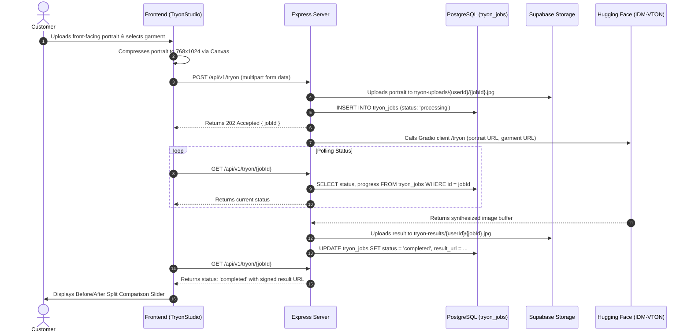

# System Architecture & Security Model

MAX-FIT is designed as a direct-to-customer men's clothing store with an integrated AI Virtual Try-On studio. The system is architected around the core principle of **server authority**: the client is responsible for presentation, image compression, and interactive controls, while the backend and PostgreSQL database maintain absolute authority over catalog state, pricing calculations, inventory decrements, cryptographic verification, and access policies.

---

## 1. High-Level Architecture Overview

```mermaid
graph TD
    Client[Web Client Browser]
    
    subgraph FrontendLayer [Frontend Application - React 19 + Vite 6]
        RouterSPA[React Router 7]
        AuthModule[Supabase Auth Integration]
        CartModule[Cart Context & Bag Engine]
        TryOnModule[Try-On Studio & Before/After Slider]
        AdminModule[Admin Management Console]
        RzpClient[Razorpay Standard Checkout SDK]
    end

    subgraph BackendLayer [Backend Application - Node.js 25 + Express]
        APIGateway[Express REST API /api/v1]
        SecurityMid[Helmet + CORS + Rate Limiting]
        AuthMiddleware[JWT Validation & Admin Role Guard]
        Controllers[Controller Layer: Cart, Order, Payment, Try-On]
        PDFService[PDFKit Invoice Generator]
        HFService[@gradio/client Integration]
    end

    subgraph PersistenceLayer [Data & Storage - Supabase Managed]
        PostgresDB[(PostgreSQL 15 Database)]
        RLSEngine{Row Level Security Policies}
        StoragePublic[(Public Bucket: products)]
        StoragePrivate[(Private Buckets: tryon-uploads, tryon-results, invoices)]
    end

    subgraph ExternalServices [Third-Party Cloud APIs]
        HuggingFace[Hugging Face Spaces - yisol/IDM-VTON]
        RazorpayAPI[Razorpay Payment Gateway API]
    end

    Client --> FrontendLayer
    FrontendLayer --> APIGateway
    FrontendLayer --> RzpClient

    APIGateway --> SecurityMid
    SecurityMid --> AuthMiddleware
    AuthMiddleware --> Controllers

    Controllers --> PostgresDB
    Controllers --> RLSEngine
    Controllers --> PDFService
    Controllers --> HFService
    Controllers --> StoragePublic
    Controllers --> StoragePrivate

    HFService --> HuggingFace
    Controllers --> RazorpayAPI
    RzpClient --> RazorpayAPI
```

---

## 2. Component Breakdown

### 2.1 Frontend Client
- **Framework & Tooling**: Built with **React 19** and **Vite 6** using modern ES modules.
- **Styling Architecture**: **Tailwind CSS v4** utilizing native `@theme` CSS tokens, eliminating external config overhead.
- **State Management**:
  - `AuthContext`: Manages active user sessions, token refresh cycles, fit profile measurements, and admin role flags.
  - `CartContext`: Synchronizes customer bag items with the backend, computing optimistic visual updates while fetching authoritative server summaries.
- **Interactive Components**:
  - `BeforeAfterSlider`: Custom touch- and mouse-responsive split slider comparing the customer's input portrait directly against the synthesized try-on output.
  - `SizeRecommenderModal`: Interactive biometric evaluation interface calculating body mass ratios and garment tolerances.

### 2.2 Backend Application
- **Runtime**: **Node.js 25** operating with native ES module syntax.
- **Middleware Pipeline**:
  - `helmet`: Sets secure HTTP response headers (Content-Security-Policy, X-Frame-Options, Strict-Transport-Security).
  - `cors`: Restricts cross-origin requests strictly to authorized client domains.
  - `express-rate-limit`: Applied globally (100 requests per 15 minutes) with specialized strict limits on payment and virtual try-on endpoints.
  - `requireAuth`: Validates Supabase JWT bearer tokens using `supabaseAdmin.auth.getUser()`.
  - `requireAdmin`: Checks the verified user's profile role against the database `profiles` table to restrict administrative endpoints.
- **Services**:
  - `vtonService.js`: Communicates via `@gradio/client` with the `yisol/IDM-VTON` Hugging Face Space over WebSockets and REST.
  - `invoiceService.js`: Renders structured tax invoices using `pdfkit` and uploads them to the private `invoices` storage bucket.

### 2.3 Persistence & Storage Layer
- **PostgreSQL 15**: Relational persistence utilizing strict foreign keys, check constraints, unique constraints, and atomic stored procedures.
- **Supabase Storage**:
  - `products` (Public): Publicly accessible product photography and catalog media.
  - `tryon-uploads` (Private): Encrypted customer portrait uploads; access governed by folder-based user ID matching.
  - `tryon-results` (Private): Generated diffusion synthesis images; served via short-lived signed URLs.
  - `invoices` (Private): Generated PDF tax documents; accessible only by the owning customer and administrators via signed URLs.

---

## 3. Data Flow Diagrams

### 3.1 AI Virtual Try-On Pipeline



---

### 3.2 Checkout, Razorpay Payment & Atomic Stock Decrement

```mermaid
sequenceDiagram
    autonumber
    actor Customer
    participant Client as Frontend (Checkout)
    participant Server as Express Server
    participant Razorpay as Razorpay API
    participant DB as PostgreSQL

    Customer->>Client: Selects Delivery Address & clicks "Pay Now"
    Client->>Server: POST /api/v1/payments/create-order { addressId, buyNowVariantId? }
    
    Server->>DB: Validates address & checks variant stock availability
    Server->>Server: Computes authoritative total, dual-tier GST, and shipping fee
    Server->>DB: INSERT INTO orders (status: 'pending', total: ...)
    Server->>Razorpay: Creates Razorpay Order (amount in paise, INR)
    Razorpay-->>Server: Returns razorpay_order_id
    Server->>DB: Updates order with razorpay_order_id
    Server-->>Client: Returns { orderId, orderNumber, razorpayOrderId, amount, keyId }

    Client->>Customer: Opens Razorpay Standard Checkout Modal
    Customer->>Client: Completes payment (UPI / Card / NetBanking)
    
    Client->>Server: POST /api/v1/payments/verify { orderId, razorpay_payment_id, razorpay_signature }
    Server->>Server: Verifies timing-safe HMAC SHA256 signature
    
    critical Atomic Inventory Lock
        Server->>DB: SELECT decrement_variant_stock(variant_id, qty)
        Note over DB: Decrements stock atomically; raises error if stock < qty
    end

    Server->>DB: UPDATE orders SET status = 'paid', payment_status = 'captured'
    Server->>Server: Triggers background PDF tax invoice generation
    Server-->>Client: Returns { success: true, orderNumber }
    Client->>Customer: Navigates to /order-success/{orderNumber}
```

---

## 4. Security & Compliance Architecture

### 4.1 Server-Side Authoritative Financials
Client-submitted prices, discounts, and tax values are **strictly ignored**. When an order is created or previewed:
1. Item unit prices are queried directly from the verified database record for each variant.
2. Dual-tier apparel GST is calculated mathematically:
   - Items with unit price under ₹1,000: 5% GST included ($\text{subtotal} \times \frac{5}{105}$).
   - Items with unit price ₹1,000 or above: 12% GST included ($\text{subtotal} \times \frac{12}{112}$).
3. Coupon codes are validated against expiration dates, usage limits, and minimum order requirements directly within the database before discount application.
4. Shipping rules evaluate net subtotal (post-discount): free delivery for orders ₹999 and above; flat ₹79 otherwise.

### 4.2 Cryptographic Payment Verification
Payment verification does not rely on browser client redirection callbacks alone:
- **Timing-Safe HMAC SHA256 Comparison**:
  $$\text{expectedSignature} = \text{HMAC-SHA256}(\text{order\_id} + "|" + \text{payment\_id}, \text{RZP\_KEY\_SECRET})$$
  Signatures are compared using Node.js `crypto.timingSafeEqual()` to eliminate side-channel timing attacks.
- **Idempotent Webhook Processing**:
  The `/api/v1/payments/webhook` handler verifies the Razorpay signature header before processing. If an order has already transitioned to `paid`, duplicate webhook events are logged and gracefully acknowledged without executing duplicate stock deductions.

### 4.3 Database Row Level Security (RLS)
PostgreSQL Row Level Security is enabled on **all 11 domain tables**:
- Public tables (`categories`, `size_chart`, `products`, `product_variants`) permit `SELECT` operations to all roles, but restrict `INSERT`, `UPDATE`, and `DELETE` strictly to administrators via the `is_admin()` SQL function.
- Customer-owned tables (`profiles`, `addresses`, `cart_items`, `wishlist_items`, `orders`, `order_items`, `tryon_jobs`) enforce `auth.uid() = user_id` for read and write operations.
- Administrators bypass customer-specific ownership filters through the unified `is_admin()` security definer function.

### 4.4 Atomic Inventory Concurrency Control
Race conditions during high-concurrency checkout scenarios are prevented at the database level:
- Stored procedure `decrement_variant_stock(p_variant_id UUID, p_qty INT)` utilizes row-level locking (`SELECT ... FOR UPDATE` semantics via conditional `UPDATE WHERE stock >= p_qty`).
- If inventory is insufficient, an exception is raised, aborting the transaction and prompting the payment controller to reject the order before capturing funds.
- If an order is canceled, `restore_variant_stock` atomically returns the exact quantities to inventory.
