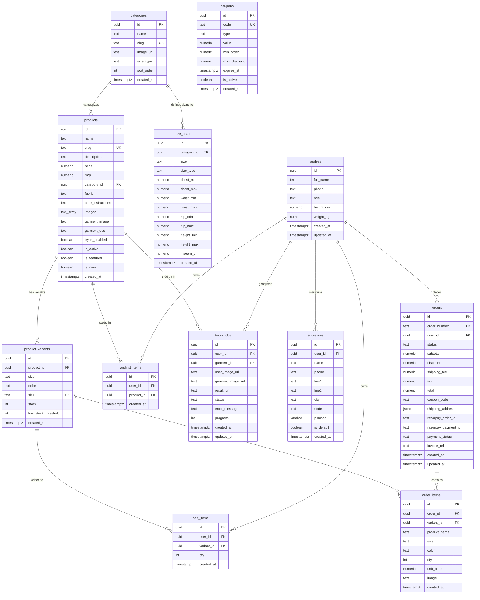

# Database Schema, Functions & Security Policies

MAX-FIT uses PostgreSQL 15 managed through Supabase with Row Level Security (RLS) enabled across all public domain tables. The database schema enforces relational integrity, atomic inventory management, server-side business rules, and granular data isolation.

The complete turnkey SQL script representing the entire database schema from scratch is located at [`supabase/schema.sql`](file:///c:/Users/ASUS/Downloads/MAXFIT/supabase/schema.sql).

---

## 1. Entity Relationship Diagram



---

## 2. Table Specifications

### 2.1 `categories`
Organizes men's apparel into 7 structured catalog groupings.
- `id` (UUID, Primary Key, Default: `gen_random_uuid()`)
- `name` (TEXT, NOT NULL): Category display title.
- `slug` (TEXT, NOT NULL, UNIQUE): URL path identifier (e.g., `checks-shirt`, `cargo`).
- `image_url` (TEXT): Category cover photograph.
- `size_type` (TEXT, NOT NULL, Default: `'top'`, Check: `size_type IN ('top', 'bottom')`): Garment classification driving sizing rules.
- `sort_order` (INT, NOT NULL, Default: `0`): Navigation priority order.
- `created_at` (TIMESTAMPTZ, NOT NULL, Default: `timezone('utc'::text, now())`)

### 2.2 `products`
The central men's garment catalog entity.
- `id` (UUID, Primary Key, Default: `gen_random_uuid()`)
- `name` (TEXT, NOT NULL): Product title.
- `slug` (TEXT, NOT NULL, UNIQUE): URL slug for SEO routing.
- `description` (TEXT): Fabric, cut, and design details.
- `price` (NUMERIC(10,2), NOT NULL, Check: `price > 0`): Current selling price in INR.
- `mrp` (NUMERIC(10,2), NOT NULL, Check: `mrp >= price`): Original maximum retail price.
- `category_id` (UUID, References: `categories(id)` ON DELETE SET NULL): Parent category.
- `fabric` (TEXT): Composition details (e.g. `100% Combed Cotton, 240 GSM`).
- `care_instructions` (TEXT): Washing and maintenance guidance.
- `images` (TEXT[], NOT NULL, Default: `'{}'`): Array of gallery image URLs.
- `garment_image` (TEXT): Primary flat-lay or ghost-mannequin studio photo.
- `garment_des` (TEXT): Descriptive prompt text for IDM-VTON neural guidance.
- `tryon_enabled` (BOOLEAN, NOT NULL, Default: `true`): Flag enabling Virtual Try-On Studio compatibility.
- `is_active` (BOOLEAN, NOT NULL, Default: `true`): Storefront visibility status.
- `is_featured` (BOOLEAN, NOT NULL, Default: `false`): Featured collection badge.
- `is_new` (BOOLEAN, NOT NULL, Default: `false`): New arrival indicator.
- `created_at` (TIMESTAMPTZ, NOT NULL, Default: `timezone('utc'::text, now())`)

### 2.3 `product_variants`
Tracks SKU-level inventory per size and color combination.
- `id` (UUID, Primary Key, Default: `gen_random_uuid()`)
- `product_id` (UUID, NOT NULL, References: `products(id)` ON DELETE CASCADE)
- `size` (TEXT, NOT NULL, Check: `size IN ('S', 'M', 'L', 'XL', 'XXL', '28', '30', '32', '34', '36', '38')`)
- `color` (TEXT, NOT NULL): Garment color designation.
- `sku` (TEXT, NOT NULL, UNIQUE): Machine-readable stock identifier.
- `stock` (INT, NOT NULL, Default: `0`, Check: `stock >= 0`): Real-time stock units available.
- `low_stock_threshold` (INT, NOT NULL, Default: `5`, Check: `low_stock_threshold >= 0`): Alert trigger boundary.
- `created_at` (TIMESTAMPTZ, NOT NULL, Default: `timezone('utc'::text, now())`)
- **Constraint**: `UNIQUE (product_id, size, color)`

### 2.4 `profiles`
Customer and administrative user fit profiles.
- `id` (UUID, Primary Key, References: `auth.users(id)` ON DELETE CASCADE)
- `full_name` (TEXT): Customer display name.
- `phone` (TEXT): Contact number.
- `role` (TEXT, NOT NULL, Default: `'customer'`, Check: `role IN ('customer', 'admin')`)
- `height_cm` (NUMERIC(5,2)): Height for biometric sizing.
- `weight_kg` (NUMERIC(5,2)): Weight for biometric sizing.
- `created_at` (TIMESTAMPTZ, NOT NULL, Default: `timezone('utc'::text, now())`)
- `updated_at` (TIMESTAMPTZ, NOT NULL, Default: `timezone('utc'::text, now())`)

### 2.5 `addresses`
Saved shipping address book for customers.
- `id` (UUID, Primary Key, Default: `gen_random_uuid()`)
- `user_id` (UUID, NOT NULL, References: `auth.users(id)` ON DELETE CASCADE)
- `name` (TEXT, NOT NULL): Recipient full name.
- `phone` (TEXT, NOT NULL): Recipient delivery contact number.
- `line1` (TEXT, NOT NULL): House, flat, or building identifier.
- `line2` (TEXT): Street, area, or landmark.
- `city` (TEXT, NOT NULL): Delivery city.
- `state` (TEXT, NOT NULL): Delivery state.
- `pincode` (VARCHAR(6), NOT NULL): 6-digit postal code.
- `is_default` (BOOLEAN, NOT NULL, Default: `false`)
- `created_at` (TIMESTAMPTZ, NOT NULL, Default: `timezone('utc'::text, now())`)

### 2.6 `cart_items`
Persistent user shopping bag items.
- `id` (UUID, Primary Key, Default: `gen_random_uuid()`)
- `user_id` (UUID, NOT NULL, References: `auth.users(id)` ON DELETE CASCADE)
- `variant_id` (UUID, NOT NULL, References: `product_variants(id)` ON DELETE CASCADE)
- `qty` (INT, NOT NULL, Default: `1`, Check: `qty > 0`): Selected purchase quantity.
- `created_at` (TIMESTAMPTZ, NOT NULL, Default: `timezone('utc'::text, now())`)
- **Constraint**: `UNIQUE (user_id, variant_id)`

### 2.7 `wishlist_items`
Saved product shortlist.
- `id` (UUID, Primary Key, Default: `gen_random_uuid()`)
- `user_id` (UUID, NOT NULL, References: `auth.users(id)` ON DELETE CASCADE)
- `product_id` (UUID, NOT NULL, References: `products(id)` ON DELETE CASCADE)
- `created_at` (TIMESTAMPTZ, NOT NULL, Default: `timezone('utc'::text, now())`)
- **Constraint**: `UNIQUE (user_id, product_id)`

### 2.8 `coupons`
Promotional discount definitions.
- `id` (UUID, Primary Key, Default: `gen_random_uuid()`)
- `code` (TEXT, NOT NULL, UNIQUE): Uppercase promotional coupon code.
- `type` (TEXT, NOT NULL, Check: `type IN ('percent', 'flat')`): Calculation method.
- `value` (NUMERIC(10,2), NOT NULL, Check: `value > 0`): Percentage discount or flat INR amount.
- `min_order` (NUMERIC(10,2), NOT NULL, Default: `0`, Check: `min_order >= 0`): Minimum subtotal requirement.
- `max_discount` (NUMERIC(10,2)): Optional discount ceiling for percentage coupons.
- `expires_at` (TIMESTAMPTZ): Optional expiration deadline.
- `is_active` (BOOLEAN, NOT NULL, Default: `true`)
- `created_at` (TIMESTAMPTZ, NOT NULL, Default: `timezone('utc'::text, now())`)

### 2.9 `orders`
Customer orders and fulfillment status.
- `id` (UUID, Primary Key, Default: `gen_random_uuid()`)
- `order_number` (TEXT, NOT NULL, UNIQUE): Formatted reference (`ORD-YYYY-XXXXXX`).
- `user_id` (UUID, NOT NULL, References: `auth.users(id)` ON DELETE CASCADE)
- `status` (TEXT, NOT NULL, Default: `'pending'`, Check: `status IN ('pending', 'paid', 'processing', 'shipped', 'delivered', 'cancelled')`)
- `subtotal` (NUMERIC(10,2), NOT NULL, Check: `subtotal >= 0`)
- `discount` (NUMERIC(10,2), NOT NULL, Default: `0`, Check: `discount >= 0`)
- `shipping_fee` (NUMERIC(10,2), NOT NULL, Default: `0`, Check: `shipping_fee >= 0`)
- `tax` (NUMERIC(10,2), NOT NULL, Default: `0`, Check: `tax >= 0`): Total GST included in order.
- `total` (NUMERIC(10,2), NOT NULL, Check: `total >= 0`): Net payable amount.
- `coupon_code` (TEXT): Applied promotional coupon code.
- `shipping_address` (JSONB, NOT NULL): Snapshotted shipping address at checkout time.
- `razorpay_order_id` (TEXT): Associated Razorpay Order ID.
- `razorpay_payment_id` (TEXT): Captured Razorpay Payment ID.
- `payment_status` (TEXT, NOT NULL, Default: `'pending'`, Check: `payment_status IN ('pending', 'captured', 'failed', 'refunded')`)
- `invoice_url` (TEXT): Storage path to vector PDF invoice.
- `created_at` (TIMESTAMPTZ, NOT NULL, Default: `timezone('utc'::text, now())`)
- `updated_at` (TIMESTAMPTZ, NOT NULL, Default: `timezone('utc'::text, now())`)

### 2.10 `order_items`
Itemized line-item snapshot for each order.
- `id` (UUID, Primary Key, Default: `gen_random_uuid()`)
- `order_id` (UUID, NOT NULL, References: `orders(id)` ON DELETE CASCADE)
- `variant_id` (UUID, References: `product_variants(id)` ON DELETE SET NULL)
- `product_name` (TEXT, NOT NULL): Product title snapshotted at purchase.
- `size` (TEXT, NOT NULL): Size selected at purchase.
- `color` (TEXT, NOT NULL): Color selected at purchase.
- `qty` (INT, NOT NULL, Check: `qty > 0`): Units purchased.
- `unit_price` (NUMERIC(10,2), NOT NULL, Check: `unit_price >= 0`): Price per unit in INR.
- `image` (TEXT): Garment photo URL snapshotted at purchase.
- `created_at` (TIMESTAMPTZ, NOT NULL, Default: `timezone('utc'::text, now())`)

### 2.11 `tryon_jobs`
Virtual try-on synthesis job queue and history.
- `id` (UUID, Primary Key, Default: `gen_random_uuid()`)
- `user_id` (UUID, NOT NULL, References: `auth.users(id)` ON DELETE CASCADE)
- `garment_id` (UUID, NOT NULL, References: `products(id)` ON DELETE CASCADE)
- `user_image_url` (TEXT, NOT NULL): Path to customer input portrait in `tryon-uploads`.
- `garment_image_url` (TEXT, NOT NULL): Path to garment image in `products`.
- `result_url` (TEXT): Path to synthesized output image in `tryon-results`.
- `status` (TEXT, NOT NULL, Default: `'queued'`, Check: `status IN ('queued', 'processing', 'completed', 'failed')`)
- `error_message` (TEXT): Error description in case of inference failure.
- `progress` (INT, NOT NULL, Default: `0`, Check: `progress >= 0 AND progress <= 100`)
- `created_at` (TIMESTAMPTZ, NOT NULL, Default: `timezone('utc'::text, now())`)
- `updated_at` (TIMESTAMPTZ, NOT NULL, Default: `timezone('utc'::text, now())`)

### 2.12 `size_chart`
Biometric reference metrics per category and size.
- `id` (UUID, Primary Key, Default: `gen_random_uuid()`)
- `category_id` (UUID, NOT NULL, References: `categories(id)` ON DELETE CASCADE)
- `size` (TEXT, NOT NULL, Check: `size IN ('S', 'M', 'L', 'XL', 'XXL', '28', '30', '32', '34', '36', '38')`)
- `size_type` (TEXT, NOT NULL, Default: `'top'`, Check: `size_type IN ('top', 'bottom')`)
- `chest_min` (NUMERIC(5,2)), `chest_max` (NUMERIC(5,2)): Chest range in cm (tops).
- `waist_min` (NUMERIC(5,2)), `waist_max` (NUMERIC(5,2)): Waist range in cm.
- `hip_min` (NUMERIC(5,2)), `hip_max` (NUMERIC(5,2)): Hip range in cm.
- `height_min` (NUMERIC(5,2)), `height_max` (NUMERIC(5,2)): Recommended height range in cm.
- `inseam_cm` (NUMERIC(5,2)): Inseam measurement in cm (bottoms).
- `created_at` (TIMESTAMPTZ, NOT NULL, Default: `timezone('utc'::text, now())`)

---

## 3. Stored Procedures & Database Functions

### 3.1 `decrement_variant_stock(p_variant_id UUID, p_qty INT)`
Executes atomic stock deduction inside an isolated database transaction:
```sql
CREATE OR REPLACE FUNCTION public.decrement_variant_stock(
    p_variant_id UUID,
    p_qty INT
)
RETURNS void AS $$
DECLARE
    v_current_stock INT;
BEGIN
    SELECT stock INTO v_current_stock
    FROM public.product_variants
    WHERE id = p_variant_id
    FOR UPDATE;

    IF v_current_stock IS NULL THEN
        RAISE EXCEPTION 'Variant % not found', p_variant_id;
    END IF;

    IF v_current_stock < p_qty THEN
        RAISE EXCEPTION 'Insufficient stock for variant %. Available: %, Requested: %',
            p_variant_id, v_current_stock, p_qty;
    END IF;

    UPDATE public.product_variants
    SET stock = stock - p_qty
    WHERE id = p_variant_id;
END;
$$ LANGUAGE plpgsql SECURITY DEFINER;
```

### 3.2 `restore_variant_stock(p_variant_id UUID, p_qty INT)`
Restores inventory units when an order is canceled:
```sql
CREATE OR REPLACE FUNCTION public.restore_variant_stock(
    p_variant_id UUID,
    p_qty INT
)
RETURNS void AS $$
BEGIN
    UPDATE public.product_variants
    SET stock = stock + p_qty
    WHERE id = p_variant_id;
END;
$$ LANGUAGE plpgsql SECURITY DEFINER;
```

### 3.3 `is_admin()`
Evaluates whether the executing authenticated user has administrative privileges:
```sql
CREATE OR REPLACE FUNCTION public.is_admin()
RETURNS boolean AS $$
BEGIN
    RETURN EXISTS (
        SELECT 1 FROM public.profiles
        WHERE id = auth.uid() AND role = 'admin'
    );
END;
$$ LANGUAGE plpgsql SECURITY DEFINER;
```

### 3.4 `generate_order_number()`
Generates formatted sequential human-readable order references (`ORD-YYYY-XXXXXX`):
```sql
CREATE OR REPLACE FUNCTION public.generate_order_number()
RETURNS text AS $$
DECLARE
    v_year TEXT := to_char(now(), 'YYYY');
    v_seq INT;
BEGIN
    SELECT COALESCE(COUNT(*), 0) + 1 INTO v_seq
    FROM public.orders
    WHERE to_char(created_at, 'YYYY') = v_year;
    
    RETURN 'ORD-' || v_year || '-' || lpad(v_seq::text, 6, '0');
END;
$$ LANGUAGE plpgsql;
```

---

## 4. Row Level Security Policies Summary

| Table | Policy Name | Permitted Roles | Command | Condition |
| :--- | :--- | :--- | :--- | :--- |
| `categories` | Public read categories | Public | `SELECT` | `true` |
| `categories` | Admin write categories | Public | `ALL` | `is_admin()` |
| `products` | Public read products | Public | `SELECT` | `(is_active = true) OR is_admin()` |
| `products` | Admin write products | Public | `ALL` | `is_admin()` |
| `product_variants` | Public read variants | Public | `SELECT` | `true` |
| `product_variants` | Admin write variants | Public | `ALL` | `is_admin()` |
| `profiles` | Users read own profile | Public | `SELECT` | `(auth.uid() = id) OR is_admin()` |
| `profiles` | Users update own profile | Public | `UPDATE` | `auth.uid() = id` |
| `addresses` | User addresses access | Public | `ALL` | `auth.uid() = user_id` |
| `cart_items` | User cart access | Public | `ALL` | `auth.uid() = user_id` |
| `wishlist_items` | User wishlist access | Public | `ALL` | `auth.uid() = user_id` |
| `coupons` | Public read active coupons | Public | `SELECT` | `(is_active = true) OR is_admin()` |
| `coupons` | Admin write coupons | Public | `ALL` | `is_admin()` |
| `orders` | User orders insert | Public | `INSERT` | `auth.uid() = user_id` |
| `orders` | User orders access | Public | `SELECT` | `(auth.uid() = user_id) OR is_admin()` |
| `orders` | Admin or user update orders| Public | `UPDATE` | `(auth.uid() = user_id) OR is_admin()` |
| `order_items` | User order items access | Public | `SELECT` | `EXISTS (SELECT 1 FROM orders WHERE orders.id = order_items.order_id AND (orders.user_id = auth.uid() OR is_admin()))` |
| `tryon_jobs` | User tryon jobs access | Public | `ALL` | `(auth.uid() = user_id) OR is_admin()` |
| `size_chart` | Public read size_chart | Public | `SELECT` | `true` |
| `size_chart` | Admin write size_chart | Public | `ALL` | `is_admin()` |

---

## 5. Storage Buckets Configuration

| Bucket Name | Visibility | Allowed MIME Types | File Size Limit | Access Controls |
| :--- | :--- | :--- | :--- | :--- |
| `products` | **Public** | `image/jpeg`, `image/png`, `image/webp` | 10 MB | Public read; Admin write (`is_admin()` or `service_role`). |
| `tryon-uploads` | **Private** | `image/jpeg`, `image/png`, `image/webp` | 10 MB | Read/Write/Delete restricted to owner (`auth.uid() = foldername`). |
| `tryon-results` | **Private** | `image/jpeg`, `image/png`, `image/webp` | 15 MB | Write restricted to `service_role`; Read restricted to owner via signed URL. |
| `invoices` | **Private** | `application/pdf` | 5 MB | Write restricted to `service_role`; Read restricted to owner via signed URL. |
