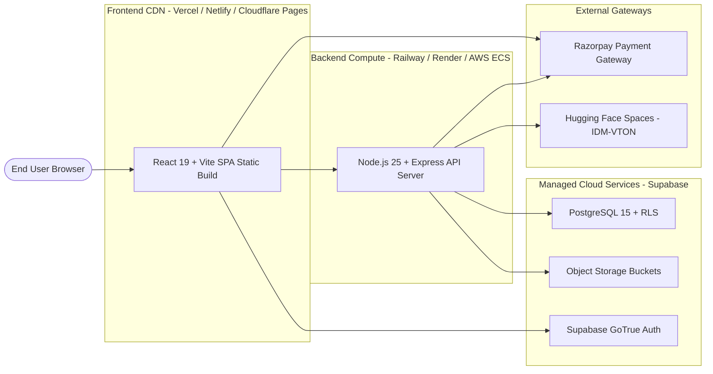

# Production Deployment Guide

This guide details the procedure for deploying the MAX-FIT direct-to-customer men's clothing e-commerce platform and AI Virtual Try-On studio to cloud environments.

---

## 1. Production Architecture Overview



---

## 2. Environment Variables Specification

All environment variables must be configured in your deployment platform's secret manager. **Never commit `.env` files into source control.**

### 2.1 Backend Environment Variables (`server/.env`)

| Variable | Required | Production Guidance |
| :--- | :---: | :--- |
| `PORT` | Yes | Port for Express listener (default: `5000` or assigned by cloud platform via `$PORT`). |
| `CLIENT_URL` | Yes | Fully-qualified public URL of the production frontend (e.g. `https://maxfit.example.com`). Used for CORS whitelist. |
| `SUPABASE_URL` | Yes | Supabase Project URL (`https://<project-ref>.supabase.co`). |
| `SUPABASE_SERVICE_ROLE_KEY` | Yes | Supabase administrative service role secret key. Grants administrative privileges for storage and RLS bypass. |
| `SUPABASE_DB_PASSWORD` | Yes | Master password for direct PostgreSQL database access. |
| `DATABASE_URL` | Yes | PostgreSQL connection string (prefer connection pooler URL on port `6543` for serverless environments). |
| `RZP_KEY_ID` | Yes | Razorpay API Key ID (`rzp_test_...` or `rzp_live_...`). |
| `RZP_KEY_SECRET` | Yes | Razorpay API Key Secret. Used for HMAC-SHA256 signature verification. |
| `RZP_WEBHOOK_SECRET` | Yes | Secret configured in the Razorpay Webhook dashboard for incoming events. |
| `HF_TOKEN` | Yes | Hugging Face Access Token with read permissions for inference execution. |
| `HF_SPACE` | Yes | Target Hugging Face Space path (default: `yisol/IDM-VTON`). |

### 2.2 Frontend Environment Variables (`client/.env`)

| Variable | Required | Production Guidance |
| :--- | :---: | :--- |
| `VITE_SUPABASE_URL` | Yes | Public Supabase project URL (`https://<project-ref>.supabase.co`). |
| `VITE_SUPABASE_ANON_KEY` | Yes | Public anonymous key for client-side Supabase Auth and session hydration. |
| `VITE_API_URL` | Yes | Public URL of the deployed Express backend (e.g. `https://api.maxfit.example.com/api/v1`). |
| `VITE_RAZORPAY_KEY_ID` | Yes | Public Razorpay Key ID for client-side checkout modal initialization. |

---

## 3. Step-by-Step Rollout Workflow

### Step 1: Database Provisioning & Schema Migration
1. Create a new PostgreSQL project on Supabase.
2. In the Supabase project dashboard, ensure database connection pooling (PgBouncer/Supavisor) is enabled.
3. Apply database schema migrations from the repository root:
   ```bash
   npm --prefix server run migrate
   ```
4. Verify all 11 domain tables and 4 storage buckets (`products`, `tryon-uploads`, `tryon-results`, `invoices`) are active and RLS is enabled.

### Step 2: Backend API Deployment
1. Connect your repository to your cloud application host (Render, Railway, Fly.io, or AWS).
2. Set the root directory to `server` or configure the build command:
   ```bash
   npm --prefix server install --production
   ```
3. Set the start command:
   ```bash
   node server/src/index.js
   ```
4. Configure all required backend environment variables in the host dashboard.
5. Deploy and verify health check:
   ```bash
   curl https://api.maxfit.example.com/health
   # Expected response: {"status":"healthy", ...}
   ```

### Step 3: Frontend Client Build & Deployment
1. Connect your repository to your static hosting provider (Vercel, Netlify, or Cloudflare Pages).
2. Set root directory to `client`.
3. Set build command:
   ```bash
   npm run build
   ```
4. Set output directory:
   ```text
   dist
   ```
5. Configure client environment variables (`VITE_SUPABASE_URL`, `VITE_SUPABASE_ANON_KEY`, `VITE_API_URL`, `VITE_RAZORPAY_KEY_ID`).
6. Deploy the client.

### Step 4: Configure Razorpay Webhooks
1. Open the **Razorpay Dashboard** &rarr; **Settings** &rarr; **Webhooks**.
2. Add a new webhook pointing to: `https://api.maxfit.example.com/api/v1/payments/webhook`.
3. Subscribe to active events:
   - `payment.captured`
   - `payment.failed`
4. Set the webhook secret and match it with `RZP_WEBHOOK_SECRET` in your server environment variables.

---

## 4. Production Process Management (PM2 Example)

For standalone Virtual Private Servers (VPS) or containerized Linux environments, manage the Node.js backend using PM2:

```javascript
// ecosystem.config.cjs
module.exports = {
  apps: [
    {
      name: 'maxfit-api',
      script: './server/src/index.js',
      instances: 'max',
      exec_mode: 'cluster',
      env_production: {
        NODE_ENV: 'production',
        PORT: 5000
      },
      max_memory_restart: '500M',
      error_file: './logs/err.log',
      out_file: './logs/out.log',
      merge_logs: true
    }
  ]
};
```

Start the cluster:
```bash
pm2 start ecosystem.config.cjs --env production
pm2 save
pm2 startup
```

---

## 5. Post-Deployment Smoke Verification Checklist

After deploying, run through this automated and manual smoke check:

1. [ ] **Health Check**: `GET /health` returns HTTP `200` with status `healthy`.
2. [ ] **Catalog Loading**: Navigate to `/shop` and verify all 7 men's categories and product cards load with images from Supabase Storage CDN.
3. [ ] **Authentication**: Register a new user, log out, and log back in.
4. [ ] **AI Virtual Try-On**: Select an upper garment, upload a portrait, and verify end-to-end synthesis with the Before/After slider.
5. [ ] **Razorpay Checkout**: Run a test transaction using a test card or UPI; verify atomic stock decrement, payment capture, and invoice generation.
6. [ ] **Admin Access**: Log in with an admin profile, access `/admin`, and verify business metrics and inventory tables.
