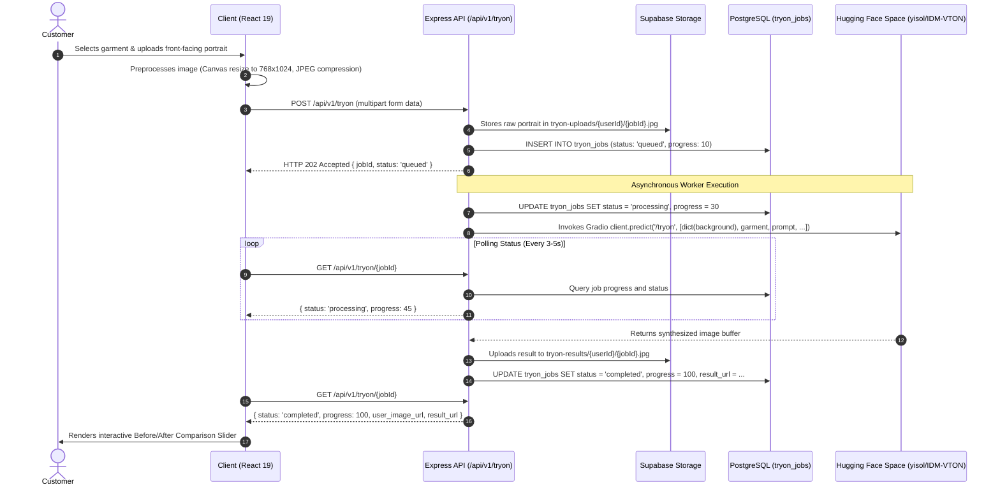

# AI Virtual Try-On Studio (IDM-VTON) Specification

MAX-FIT integrates an AI Virtual Try-On pipeline powered by **IDM-VTON** (Improving Diffusion Models for Authentic Virtual Try-On in the Wild). The studio enables customers to visualize how men's upper garments drape on their own body before making a purchase.

---

## 1. Model Overview & Technical Scope

### 1.1 Neural Diffusion Architecture
IDM-VTON leverages a dual-stream latent diffusion architecture:
1. **Try-On Condition Generator (TryonNet)**: Processes the reference garment image and extracts high-level semantic features and fine-grained fabric textures (e.g. weave, buttons, collar geometry).
2. **Visual Backbone (UNet)**: Operates on a masked representation of the customer's input portrait, retaining head, arms, posture, and background while inpainting the garment with natural shading and realistic body contouring.
3. **Prompt Conditioning**: Uses descriptive prompts (stored in `products.garment_des`) alongside the garment photograph to guide diffusion sampling toward accurate color and fabric weight fidelity.

### 1.2 Garment Compatibility Scope
The IDM-VTON diffusion network is specialized for **upper-body apparel**:
- **Fully Supported (Enabled by Default)**:
  - `Casual Shirts`
  - `Checks Shirt`
  - `Hoodies and Sweatshirt`
  - `Men's Jacket`
  - `T-shirt`
- **Bottoms Handling**:
  - For `Pants Jeans` and `Cargo`, virtual try-on is disabled by default in the administrative catalog to prevent invalid upper-body inpainting on leg geometries. Store administrators retain manual toggle capability.

---

## 2. End-to-End Processing Pipeline



---

## 3. Client-Side Image Preprocessing

To ensure deterministic latency and prevent memory exhaustion during neural diffusion:
1. **Aspect Ratio Normalization**: Customer portraits are processed client-side via an offscreen HTML5 `<canvas>`.
2. **Resolution Target**: Images are downsampled to standard **768 × 1024 pixels** (3:4 portrait ratio), matching the native latent diffusion training resolution of IDM-VTON.
3. **Compression**: Images are exported as standard JPEG at 85% quality, reducing typical phone camera payloads from ~8 MB to under 400 KB before network transit.

---

## 4. Frontend Visualization Components

### 4.1 Interactive Before/After Split Comparison Slider
Located at `client/src/components/tryon/BeforeAfterSlider.jsx`:
- **Dual-Layer Rendering**: The original customer portrait and the synthesized diffusion output are rendered in overlapping absolute containers.
- **Divider Handle**: An interactive horizontal divider with touch and drag tracking dynamically adjusts the `clip-path` of the top layer.
- **Micro-Animations**: Smooth transition boundaries enable instant comparison of shoulder drape, sleeve fit, and collar alignment.

### 4.2 Studio Actions
- **Add Fit to Bag**: Direct variant size selector (`S`, `M`, `L`, `XL`, `XXL`) and one-click cart insertion.
- **High-Resolution Download**: Triggers client-side image save with standardized naming (`MAXFIT-tryon-{orderNumber}.jpg`).
- **My Saved Fits**: Persistent historical gallery reading directly from `tryon_jobs`. Includes trash-can trigger for permanent record and file deletion.

---

## 5. Storage & Privacy Controls

Customer try-on data is protected by strict database and storage policies:
- **`tryon-uploads` Bucket**: Private bucket. Customer photos are placed in folders named after their Supabase `auth.uid()`. Storage RLS rules enforce that only the authenticated user or the backend service role can access or delete files.
- **`tryon-results` Bucket**: Private bucket. Output images are accessible solely through short-lived signed URLs generated on the server (1-hour expiration).
- **Permanent Deletion**: When a customer deletes a saved fit from their gallery, an atomic API call (`DELETE /api/v1/tryon/:id`) deletes the database row and issues Supabase Storage `remove()` calls for both the input and output assets.

---

## 6. Academic & Open-Source Licensing

- **IDM-VTON**: Released under the **Creative Commons Attribution-NonCommercial-ShareAlike 4.0 International (CC BY-NC-SA 4.0)** license.
- **Intended Use**: Academic demonstration, portfolio verification, and non-commercial educational showcase.
- **Citation**:
  ```bibtex
  @article{choi2024improving,
    title={Improving Diffusion Models for Authentic Virtual Try-on in the Wild},
    author={Choi, Yisol and Kwak, Sangkyung and Lee, Kyungmin and Choi, Minwoo and Han, Sungwon},
    journal={arXiv preprint arXiv:2403.05139},
    year={2024}
  }
  ```
